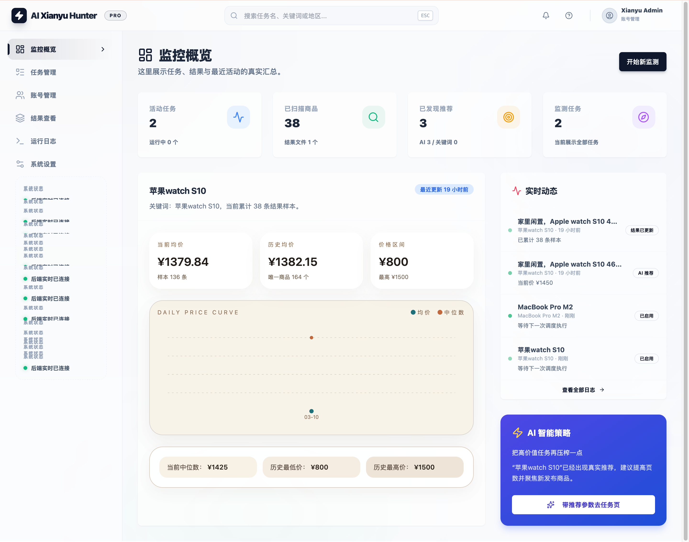
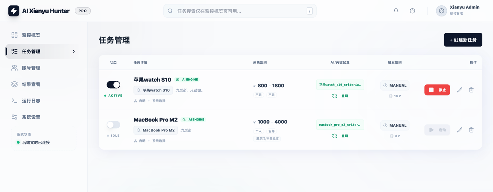
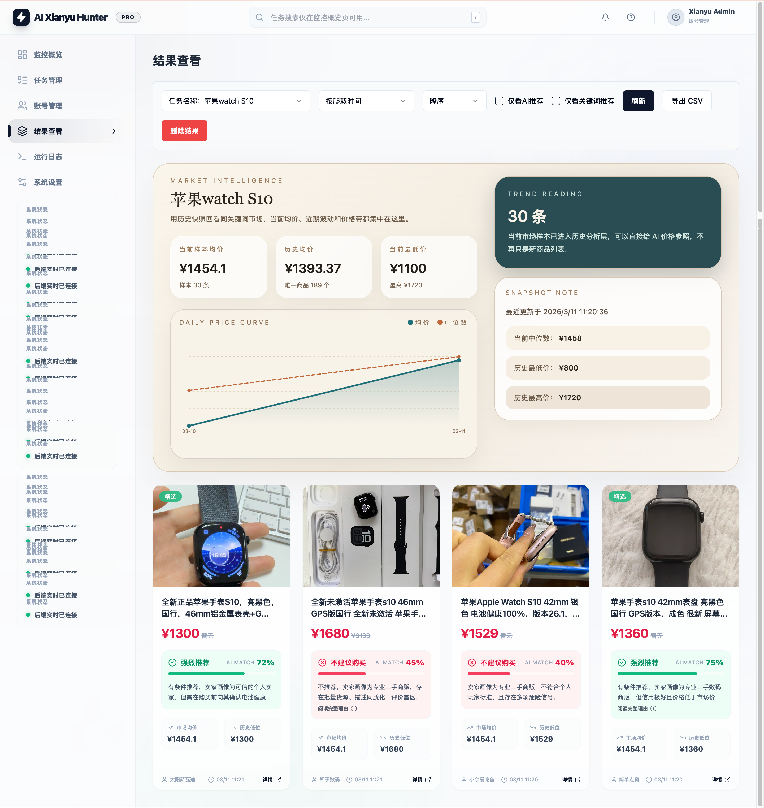
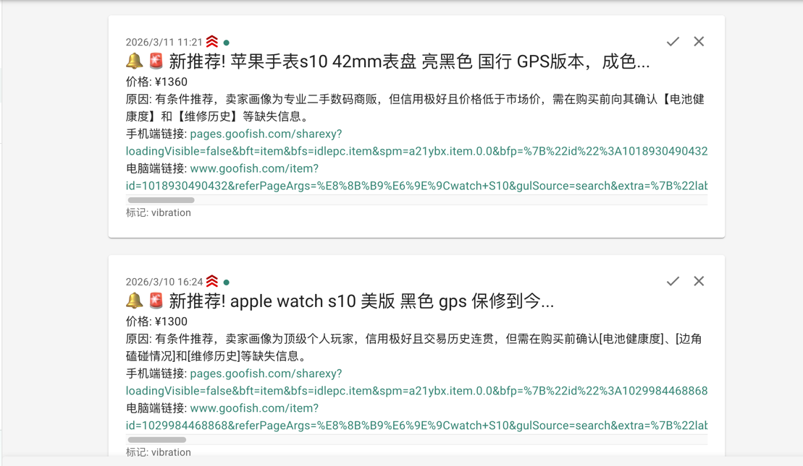
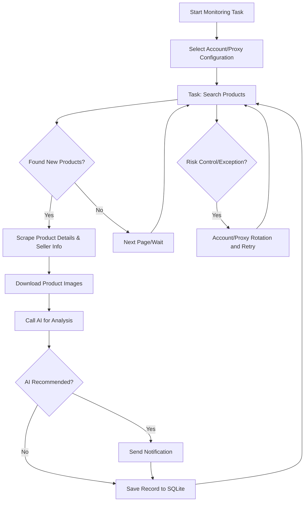

# 閑魚（Xianyu）インテリジェント監視ボット

[中文](README.md) ｜ [English](README_EN.md) ｜ [日本語]

Playwright と AI を活用した、閑魚（Xianyu）向けのマルチタスク対応リアルタイム監視ツールです。完全な Web 管理画面を備えています。

## 主な機能

- **Web でのビジュアルな管理**：タスク管理、アカウント管理、AI の判定基準の編集、実行ログ、結果の閲覧
- **AI 主導**：自然言語でのタスク作成、マルチモーダルモデルによる商品の詳細な分析
- **マルチタスクの並行実行**：キーワード、価格、フィルター、AI のプロンプトをタスクごとに個別に設定
- **SQLite をメインのストレージに**：タスク、結果、価格の履歴を、`jsonl` を繰り返しスキャンするのではなく、1 つの組み込みデータベースに永続化します
- **高度なフィルタリング**：送料無料、新着の出品期間、省/市/区による絞り込み
- **即時通知**：ntfy.sh、WeChat Work（企業微信）、Bark、Telegram、Webhook に対応
- **スケジュールタスク**：Cron 式による定期タスクの設定
- **アカウントとプロキシのローテーション**：複数アカウントの管理、タスクとアカウントの紐付け、失敗時のリトライ付きプロキシプールのローテーション
- **Docker デプロイ**：ワンクリックでのコンテナデプロイ

## スクリーンショット






## クイックスタート

### 必要なもの

- Python 3.10+
- Node.js + npm（`Node v20.18.3` でフロントエンドのビルドが完了することを確認済み）
- Playwright CLI と Chromium。初めてローカルで実行する前に、`python3 -m pip install playwright && python3 -m playwright install chromium` でインストールしてください
- デスクトップ環境では Chrome または Edge。Linux では Chromium も使えます。`start.sh` は続行する前にこの前提条件を確認します

```bash
git clone https://github.com/Usagi-org/ai-goofish-monitor
cd ai-goofish-monitor
cp .env.example .env
```

### 最小限の設定

| 変数 | 説明 | 必須 |
|----------|-------------|----------|
| `OPENAI_API_KEY` | AI モデルの API キー | はい |
| `OPENAI_BASE_URL` | OpenAI 互換 API のベース URL | はい |
| `OPENAI_MODEL_NAME` | 画像入力に対応したモデル名 | はい |
| `WEB_USERNAME` / `WEB_PASSWORD` | Web UI のログイン情報。デフォルトは `admin/admin123` | いいえ |

その他の項目については、下記の「設定」をご覧ください。

### ローカルで起動する

```bash
chmod +x start.sh
./start.sh
```

`start.sh` は、まず Playwright CLI とブラウザの前提条件を検証します。それらが利用可能であれば、プロジェクトの依存関係をインストールし、フロントエンドをビルドし、成果物をコピーして、バックエンドを起動します。

### 初回のセットアップ

1. デフォルトの Web UI `http://127.0.0.1:8000` を開いてサインインします。
2. 「閑魚アカウント管理」に移動し、[Chrome 拡張機能](https://chromewebstore.google.com/detail/xianyu-login-state-extrac/eidlpfjiodpigmfcahkmlenhppfklcoa)を使って閑魚のログイン状態の JSON をエクスポートし、貼り付けます。
3. ログイン状態のファイルは `state/` に保存されます。例：`state/acc_1.json`。
4. 「タスク管理」に戻り、タスクを作成し、必要に応じてアカウントを紐付けて実行します。

### 最初のタスクを作成する

- `AI mode`：要件の説明を入力します。送信すると、判定基準を非同期で生成している間、別の進捗ダイアログが開きます。
- `Keyword mode`：キーワードのルールを指定すると、タスクがすぐに作成されます。
- `Region filter`：手入力のテキストではなく、組み込みの閑魚のページのスナップショットに基づいた、省 / 市 / 区のセレクターを使うようになりました。

## 🐳 Docker デプロイ（推奨）

```bash
git clone https://github.com/Usagi-org/ai-goofish-monitor && cd ai-goofish-monitor
cp .env.example .env
vim .env # fill in the required values
docker compose up -d
docker compose logs -f app
docker compose down
```

- デフォルトの Web UI：`http://127.0.0.1:8000`
- 公開されている Docker イメージにはすでに Chromium が含まれているため、ホストにブラウザを追加でインストールする必要はありません。
- イメージの更新：`docker compose pull && docker compose up -d`
- `.env` の `SERVER_PORT` を変更した場合は、`docker-compose.yaml` の `ports` のマッピングも更新してください。
- `docker-compose.yaml` は、メインの SQLite データベースのディレクトリを `./data:/app/data` としてマウントするようになりました。デフォルトのデータベースファイルは `data/app.sqlite3` です
- 以下のパスはデフォルトで永続化されます：
  - `data/`：SQLite のメインストア（タスク、結果、価格の履歴）
  - `state/`：ログイン状態の Cookie ファイル
  - `prompts/`：タスクのプロンプトファイル
  - `logs/`：実行時のログ
  - `images/`：ダウンロードした商品画像と、タスクごとの一時的な画像フォルダー
  - `config.json`、`jsonl/`、`price_history/`：初回の SQLite への移行で使われる旧形式のデータソース

### ストレージと移行

- SQLite がオンラインのメインストレージになり、デフォルトのパスは `data/app.sqlite3` です
- データベースのパスは `APP_DATABASE_FILE` で上書きできます。Docker では `/app/data/app.sqlite3` に設定されます
- 起動時に、アプリはスキーマを初期化し、旧形式の `config.json`、`jsonl/`、`price_history/` から既存のデータを一度だけインポートしようとします
- `state/`、`prompts/`、`logs/`、`images/` は引き続きファイルシステムに保存され、SQLite には保存されません
- 商品画像は `images/task_images_<task_name>/` に一時的にダウンロードされ、通常はタスクの終了時に削除されます
- 初回のアップグレード後、`data/app.sqlite3` のデータベースの内容を確認したうえで、旧形式の `config.json`、`jsonl/`、`price_history/` のマウントを残すかどうかを決められます

## ユーザーガイド

<details>
<summary>クリックして Web UI の使い方を展開</summary>

### タスク管理

- AI による作成、キーワードのルール、価格の範囲、新着出品のフィルター、地域のフィルター、アカウントの紐付け、cron によるスケジュールに対応しています。
- AI によるタスクの作成はバックグラウンドのジョブとして実行され、送信後に専用の進捗ダイアログが表示されます。
- 地域のフィルターを使うと結果が大幅に減ることがあるため、空のままにしておくのが無難なデフォルトです。

### アカウント管理

- 閑魚のログイン状態のインポート、更新、削除を行えます。
- 各タスクに特定のアカウントを紐付けるか、アカウントの選択をシステムに任せることができます。

### 結果とログ

- 結果のページとエクスポートのエンドポイントは、`jsonl` ファイルを直接スキャンするのではなく、SQLite に問い合わせるようになりました。
- ログイン状態の期限切れ、ボット対策の問題、AI の呼び出しの失敗を調べるときは、まずログのページを確認してください。

### システム設定

- システムの状態の確認、プロンプトの編集、プロキシ / ローテーション関連の設定の調整を行えます。

</details>

## 開発者ガイド

### ローカルでの開発

```bash
# backend
python -m src.app
# or
uvicorn src.app:app --host 0.0.0.0 --port 8000 --reload

# frontend
cd web-ui
npm install
npm run dev
```

- FastAPI は起動時に SQLite を初期化し、必要に応じて `config.json/jsonl/price_history` から旧形式のデータを一度だけインポートします
- `spider_v2.py` は、デフォルトで SQLite からタスクを読み込むようになりました。JSON の設定は、`--config <path>` を明示的に渡した場合にのみ使われます
- ローカルのデフォルトのデータベースのパスは `data/app.sqlite3` です
- Vite の開発サーバーは、`/api`、`/auth`、`/ws` を `http://127.0.0.1:8000` にプロキシします。
- `npm run build` は `web-ui/dist/` に書き出し、`start.sh` がそれをリポジトリのルートの `dist/` にコピーします。
- FastAPI は、リポジトリのルートから `dist/index.html` と `dist/assets/` を配信します。
- `./start.sh` は、デフォルトのアプリの URL `http://localhost:8000` と API ドキュメントの URL `http://localhost:8000/docs` を表示します。

### 検証

```bash
PYTEST_DISABLE_PLUGIN_AUTOLOAD=1 pytest
cd web-ui && npm run build
```

### タスク作成の API

<details>
<summary>クリックして API の動作を展開</summary>

- `POST /api/tasks/generate`
  - `decision_mode=ai`：`job` を含む `202` を返します。クライアントは進捗をポーリングしてください。
  - `decision_mode=keyword`：作成されたタスクを直接返します。
- `GET /api/tasks/generate-jobs/{job_id}`：AI によるタスク生成の進捗を取得します。
- `POST /auth/status`：Web UI のログイン情報を検証します。

</details>

## 設定

<details>
<summary>クリックしてよく使う設定項目を展開</summary>

### AI と実行環境

- `OPENAI_API_KEY` / `OPENAI_BASE_URL` / `OPENAI_MODEL_NAME`：必須の AI モデルの設定。
- `PROXY_URL`：AI のリクエスト専用の HTTP/SOCKS5 プロキシ。
- `RUN_HEADLESS`：スクレイパーをヘッドレスで実行するかどうか。Docker では `true` のままにしてください。
- `SERVER_PORT`：バックエンドのポート。デフォルトは `8000`。
- `LOGIN_IS_EDGE`：ローカルで Chrome の代わりに Edge を使います。Docker イメージには Edge が含まれておらず、常に Chromium で実行されます。
- `PCURL_TO_MOBILE`：デスクトップ版の商品 URL をモバイル版の URL に変換します。

### 通知

- `NTFY_TOPIC_URL`
- `GOTIFY_URL` / `GOTIFY_TOKEN`
- `BARK_URL`
- `WX_BOT_URL`
- `TELEGRAM_BOT_TOKEN` / `TELEGRAM_CHAT_ID` / `TELEGRAM_API_BASE_URL`
- `WEBHOOK_*`

### プロキシのローテーションと失敗時のガード

- `PROXY_ROTATION_ENABLED`
- `PROXY_ROTATION_MODE`
- `PROXY_POOL`
- `PROXY_ROTATION_RETRY_LIMIT`
- `PROXY_BLACKLIST_TTL`
- `TASK_FAILURE_THRESHOLD`
- `TASK_FAILURE_PAUSE_SECONDS`
- `TASK_FAILURE_GUARD_PATH`

完全な一覧は `.env.example` をご覧ください。

</details>

## Web 認証

<details>
<summary>クリックして認証についての説明を展開</summary>

- Web UI はログインページを使い、`POST /auth/status` でログイン情報を検証します。
- ログイン後、フロントエンドはルートガードと WebSocket の起動のために、ローカルに認証状態を保存します。
- デフォルトのログイン情報は `admin/admin123` です。本番環境では変更してください。

</details>

## 🚀 ワークフロー

下の図は、監視タスクの中心となる処理の流れを示しています。メインのサービスは `src.app` で動作し、ユーザーの操作やスケジュールのトリガーに応じて、1 つ以上のタスクのプロセスを起動します。



## よくある質問

<details>
<summary>クリックしてよくある質問を展開</summary>

### AI によるタスクの作成に時間がかかるのはなぜですか？

AI モードでは、タスク自体を作成する前に、システムが分析の判定基準を生成します。これは現在、タスクのフォームをブロックするのではなく、別の進捗ダイアログを伴うバックグラウンドのジョブとして実行されます。

### 地域のフィルターがデフォルトでオプションになっているのはなぜですか？

地域のフィルターを使うと、結果の量が大幅に減ることがあります。まず市場を幅広くスキャンしたい場合は、空のままにしてください。

### フロントエンドのビルド成果物がないと表示されるのはなぜですか？

リポジトリのルートの `dist/` ディレクトリがないことを意味します。`./start.sh` を実行するか、`web-ui/` でフロントエンドをビルドし、成果物がルートの `dist/` にコピーされていることを確認してください。

### `./start.sh` が Playwright やブラウザがないと表示するのはなぜですか？

このスクリプトは、プロジェクトの依存関係をインストールする前に前提条件を確認します。まず Playwright CLI と Chromium をインストールし、次にシステムで Chrome、Edge、または Chromium が利用できることを確認してから、`./start.sh` を再実行してください。

</details>

## 謝辞

<details>
<summary>クリックして謝辞を展開</summary>

このプロジェクトは、開発にあたって以下の優れたプロジェクトを参考にしました。特に感謝します：

- [superboyyy/xianyu_spider](https://github.com/superboyyy/xianyu_spider)

また、スクリプトを提供してくださった LinuxDo のコントリビューターの方々にも感謝します：

- [@jooooody](https://linux.do/u/jooooody/summary)

そして、[LinuxDo](https://linux.do/) コミュニティにも感謝します。

さらに、私たちの手を自由にし、Vibe Coding の楽しさを体験させてくれた ClaudeCode/Gemini/Codex などのモデルツールにも感謝します。

</details>


## 注意事項

<details>
<summary>クリックして注意事項の詳細を展開</summary>

- 閑魚の利用規約と robots.txt のルールを守ってください。サーバーに負担をかけたり、アカウントが制限されたりしないよう、頻繁なリクエストは行わないでください。
- このプロジェクトは、学習と技術研究のみを目的としています。違法な目的には使用しないでください。
- このプロジェクトは [MIT License](LICENSE) のもとで公開されており、いかなる形式の保証もなく「現状のまま」提供されます。
- プロジェクトの作者およびコントリビューターは、本ソフトウェアの使用によって生じた直接的、間接的、付随的、または特別な損害や損失について、一切の責任を負いません。
- 詳しくは、[免責事項](DISCLAIMER.md)のファイルをご覧ください。

</details>

## Star History

[](https://www.star-history.com/#Usagi-org/ai-goofish-monitor&Date)
