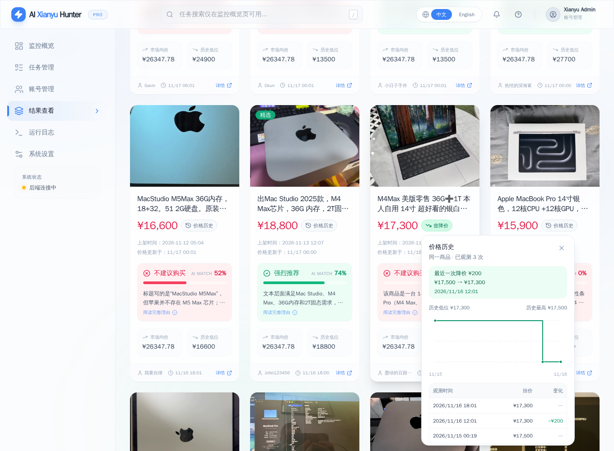
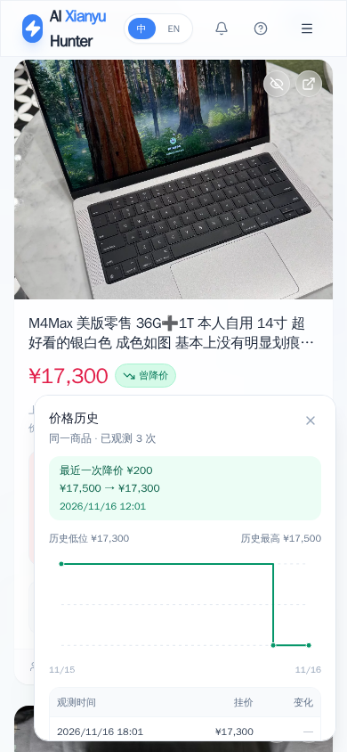

# 商品价格历史

结果卡片在售价旁提供价格历史入口；同一商品 ID 的连续观测中出现过降价时，入口显示绿色降价图标与“曾降价”。后续持平或回涨不会抹去已经发生的降价记录。桌面端悬停、键盘聚焦或移动端点击均可查看。

弹层展示价格走势、每次观测的挂价、相邻观测的变化，以及最近一次降价。单次观测明确提示不能判断涨跌，没有历史数据时不显示入口。

卡片显示最近一次观测价及时间，上架时间取闲鱼的发布时间字段；未获取时明确标注。原价缺失占位符不再显示为划线价格。历史快照不改写原始抓取记录，且不会补发 AI 分析或通知。

时间代表本系统的观测时刻，不是卖家的准确调价时刻；开始监控之前、两次抓取之间以及商品不在抓取范围内的变化可能缺失。重新发布产生不同商品 ID 时分开记录。

## 验证

- 后端：价格历史、结果 API 与解析集成测试共 15 项通过。
- 前端：TypeScript 检查和 Vite 生产构建通过。
- 浏览器：桌面悬停、键盘聚焦与 Escape、手机点击与关闭、弹层边界、单次观测、价格持平、无历史数据、未知上架时间通过检查。

## 桌面

## 手机

